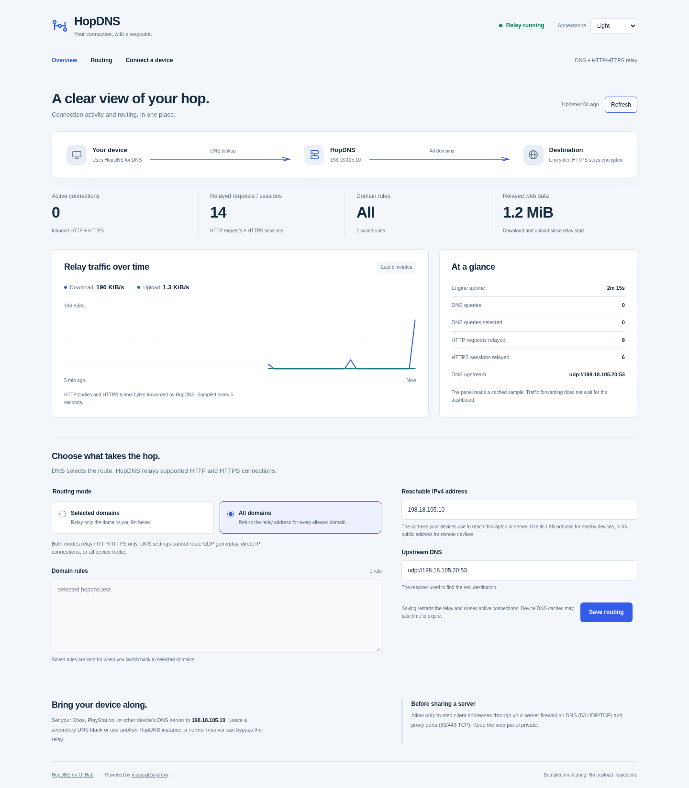

# HopDNS

Run a DNS and HTTP/HTTPS relay for a console or another device on your network.
HopDNS runs as a single executable on Windows, macOS, and Linux, or in Docker.
Manage it from your browser.

[English guide](https://mkay1375.github.io/hopdns/) ·
[راهنمای فارسی](https://mkay1375.github.io/hopdns/fa/) ·
[Deployment and development reference](docs/reference.md)



## Get started

**Native app.** Download the archive for your OS and processor from a successful
[main build](https://github.com/mkay1375/hopdns/actions/workflows/native.yaml?query=branch%3Amain+event%3Apush+is%3Asuccess).
Extract it and run `./hopdns` in Terminal or `.\hopdns.exe` in PowerShell.
The app opens your browser at [localhost:48741](http://localhost:48741).

**Docker.** Download the [Compose file](https://raw.githubusercontent.com/mkay1375/hopdns/main/compose.yaml) as `compose.yaml`, then run
these commands from its folder:

```sh
docker compose pull
docker compose up -d
```

To pull the image directly, run `docker pull ghcr.io/mkay1375/hopdns:latest`.
Open [localhost:48741](http://localhost:48741) to configure it.

## Connect a device

1. Follow the [LAN setup for your install](docs/reference.md#laptop-lan-and-server-deployment).
2. Enter the computer's LAN IPv4 address in the panel and save your routing rules.
3. Set the device's manual DNS to that address. Keep HopDNS running while connected.

HopDNS relays supported HTTP and HTTPS traffic. UDP gameplay and direct IP
connections follow the device's normal route. [Routing details](docs/reference.md#what-routing-means)

Licensed under [MIT](LICENSE). The relay uses [mosajjal/sniproxy](https://github.com/mosajjal/sniproxy).
See the [third-party notices](THIRD_PARTY_NOTICES.md).
